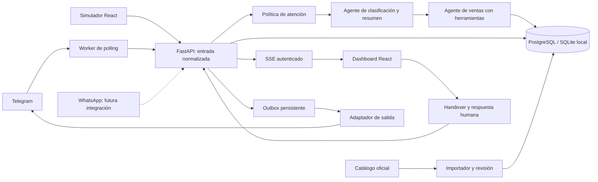

# Arquitectura de CTT Connect

## Capas

- `catalog.py`: extracción acotada a páginas públicas conocidas, sin ejecutar HTML ni seguir enlaces arbitrarios. Cada URL es una edición. Importa propuestas; la publicación es explícita.
- `triage.py`: agente semántico de salida estructurada para estado, motivo y resumen. No tiene herramientas para modificar cursos, matrículas ni precios.
- `agent.py`: agente de atención. Herramientas permitidas: listado de cursos aprobados, detalle aprobado, registro de interés y perfil limitado. No puede modificar precios, marcar matrícula ni consultar secretos.
- `policy.py`: barrera determinista ante algunas instrucciones de suplantación o alteración de políticas. Complementa el prompt, no sustituye las evaluaciones del modelo.
- `main.py`: API autenticada, persistencia, idempotencia de entrada, coordinación del handover, SSE y entrega.
- `channels.py`: protocolo de salida. No contiene reglas comerciales.
- `telegram_worker.py`: adaptador de entrada y consumidor de bandeja. La identidad del canal se establece en una ruta interna protegida, no en un campo manipulable por el visitante.

## Concurrencia y handover

La V1 usa un proceso API. Se serializan mensajes por conversación. Una tarea hija contiene la inferencia; la intervención del operador marca la conversación en pausa antes de cancelar esa tarea. El mensaje entrante ya está guardado y permanece disponible aunque la inferencia se cancele. El backend vuelve a verificar el estado al despachar respuestas pendientes. Una respuesta ya entregada al proveedor antes del clic no puede retirarse.

La transmisión al dashboard es SSE autenticado con `fetch`, no tokens en la URL. Notifica cambios y el cliente recupera el estado de la API; se reconecta automáticamente. Las ediciones del formulario deben guardarse explícitamente.

## Extensión de WhatsApp

1. Añadir `WhatsAppChannel` a `channel_for`, con envío autorizado de Cloud API.
2. Crear webhook HTTPS: verificación de suscripción y de firma, filtros de eventos, normalización de mensaje/remitente y deduplicación de IDs.
3. Invocar `ingest('whatsapp', entrada, db)`; el ID se conserva por canal para evitar mezclar identidades.
4. Extender la outbox para el canal y registrar estados de entrega mediante webhooks.
5. Aplicar la ventana de atención y las plantillas autorizadas antes de responder como asesor fuera de ventana. El envío usa el mismo backend y la misma pausa.
6. Incorporar gestión de consentimiento y pruebas del proveedor. No fusionar prospectos entre canales sin una vinculación explícita de identidad.

## Despliegue y escalado

Docker Compose: PostgreSQL, API, Nginx/React y worker opcional. Nginx sirve todo bajo un origen para evitar CORS y soportar SSE. HTTPS y dominio se configuran en el proxy del servidor de destino.

Para varias réplicas, reemplazar locks/tareas locales por exclusión y cancelación distribuidas, trasladar inferencia/entrega a una cola con backoff y dead-letter, difundir eventos con PubSub e incorporar identidades y permisos de operadores. Añadir paginación de consultas (la V1 limita listados a 1000 registros) y métricas de latencia, gasto y entrega.
